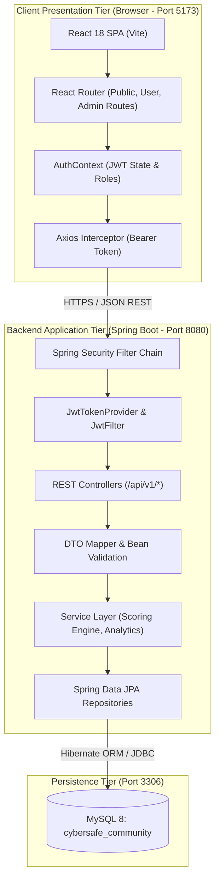
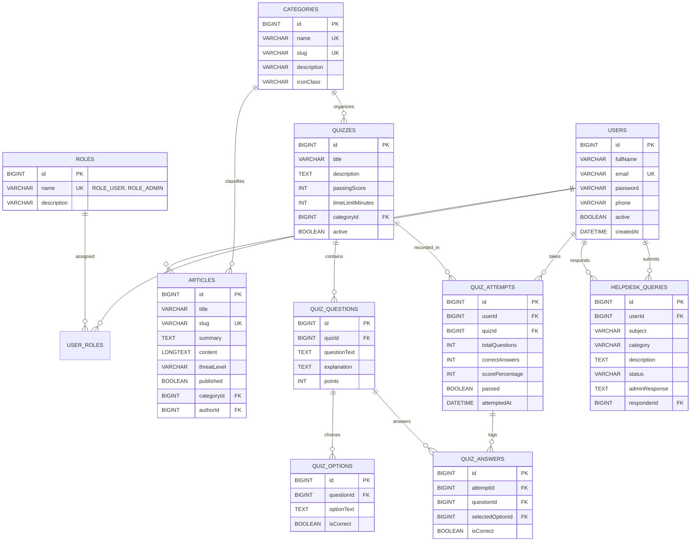

# CyberSafe Community – Community Cyber Safety & Awareness Portal

**A Full-Stack Web Application for Digital Fraud Awareness, Interactive Scenarios, and Community Assistance**  
**Course:** B.Sc. Information Technology – Semester 5  
**Subject:** Community Engagement Project (CEP)  
**Academic Year:** 2026–2027  

---

## 1. Project Title & Abstract

### Title
**CyberSafe Community – A Full-Stack Community Cyber Safety & Awareness Portal**

### Abstract
With the rapid nationwide expansion of digital payments (Unified Payments Interface - UPI), online banking, and smartphone-based public services, cybercrime has shifted from complex technical infrastructure attacks to social engineering and human manipulation. Everyday community members—particularly senior citizens, young college students, and first-time smartphone users—are routinely targeted by deceptive buyers on second-hand marketplaces, electricity bill disconnection threats, remote screen-sharing app scams (AnyDesk), and predatory part-time job schemes.

**CyberSafe Community** is a genuine, responsive, full-stack web application developed to address this urgent social challenge. Built on a decoupled 3-tier enterprise architecture using **Java 21, Spring Boot 3, Spring Security, Hibernate/JPA, MySQL 8, and React 18 with Vite and Bootstrap 5**, the portal provides curated educational resources, authentic scam alerts, interactive server-evaluated multiple-choice quizzes with post-submission rationale, and a dedicated Community Cyber Safety Helpdesk for reporting and clarifying suspicious digital encounters.

---

## 2. Problem Statement

India witnesses thousands of cyber fraud cases daily. Investigations by law enforcement reveal that over **85% of retail financial losses occur because victims unknowingly authorize transactions** under false pretenses:
1. **The UPI PIN Misconception:** Victims believe that entering a UPI PIN is required to receive funds or claim rewards.
2. **Artificial Psychological Panic:** Phishing and Smishing messages threaten disconnection of electricity or blocking of SIM cards within hours.
3. **Remote Control Hijacking:** Scammers convince non-technical citizens to download remote-access apps (AnyDesk, TeamViewer) under the guise of "customer support" or "pending refund verification."
4. **Lack of an Accessible, Non-Judgmental Community Helpdesk:** Citizens often have nowhere to ask whether a message is authentic before taking action.

---

## 3. Aim & Objectives

### Aim
To develop and deploy a community-centered cyber awareness platform that equips everyday citizens with practical scam-detection instincts and provides direct advisory assistance.

### Objectives
1. **Educate:** Publish clear, categorized, threat-rated guides explaining real scam tactics (UPI QR traps, KYC smishing, password hygiene).
2. **Simulate & Assess:** Implement interactive, server-evaluated quizzes that test users against realistic digital dilemmas without exposing answer keys on the client side.
3. **Assist:** Provide a Community Helpdesk where registered citizens can submit questions about suspicious SMS, calls, or links and receive expert guidance from moderators.
4. **Analyze:** Equip community administrators with a real-time analytics dashboard featuring Recharts data visualizations on user performance and ticket resolution.
5. **Measure Impact:** Enable students to conduct baseline pre-surveys and post-demonstration assessments to document genuine awareness growth for academic fieldwork.

---

## 4. Alignment with University CEP Syllabus Topics

The portal directly implements the 6 core themes outlined in the University CEP curriculum:

| # | University CEP Syllabus Topic | Application Implementation |
|---|---|---|
| **1** | **Cybercrime Awareness & Prevention Workshops** | Structured educational catalog with category tags, executive summaries, threat level indicators, and keyword search. |
| **2** | **Phishing, Scam and Fraud Detection Awareness Program** | Specialized scam alert modules dissecting deceptive SMS text, urgent electricity notices, and fake lottery lures. |
| **3** | **Password Hygiene & Personal Data Protection Campaign** | Passphrase best practices, Two-Factor Authentication (2FA) guidelines, and user password management. |
| **4** | **Cyber Ethics & Responsible Internet Usage Program** | Digital footprint awareness, verifying sources before forwarding misinformation, and IT Act responsibilities. |
| **5** | **Online Safety for Children & Adolescents** | Safe multiplayer gaming lobbies advice, cyberbullying mitigation, and privacy settings for minors. |
| **6** | **Community Helpdesk for Cyber Safety Queries** | Structured ticket tracking system (`PENDING` ➔ `IN_PROGRESS` ➔ `RESOLVED`) with private user records and moderator replies. |

---

## 5. Technology Stack

### Frontend (Client Tier)
- **Framework:** React 18 (Functional components with Hooks: `useState`, `useEffect`, `useContext`)
- **Build Tool:** Vite 5 (High-speed Hot Module Replacement and production bundling)
- **Routing:** React Router DOM 6 (Client-side routing with role-based `ProtectedRoute`)
- **HTTP Client:** Axios 1.7 (Centralized client with automatic JWT Bearer token injection and 401 handling)
- **UI & Styling:** Bootstrap 5.3 + Bootstrap Icons + Lucide React
- **Data Visualization:** Recharts 2.13 (Responsive BarCharts for quiz scores and PieCharts for helpdesk status)
- **Theme:** Custom Cyber Navy/Teal design system with threat level badges and glassmorphic cards

### Backend (Application & Business Tier)
- **Runtime & Language:** Java 21 / 23 LTS
- **Framework:** Spring Boot 3.3.4
- **Web Layer:** Spring Web (RESTful APIs with Jackson JSON serialization)
- **Security:** Spring Security 6 (Stateless JWT token authentication, BCrypt password hashing, and Role-Based Access Control)
- **JWT Library:** JJWT 0.12.5 (HMAC-SHA256 signature and claims verification)
- **Persistence & ORM:** Spring Data JPA / Hibernate (Entity mapping, JPQL queries, connection pooling via HikariCP)
- **Validation:** Jakarta Bean Validation (`@Valid`, `@NotBlank`, `@Email`, `@Size`)
- **Build Tool:** Apache Maven 3.9.6 (Included portable Maven wrapper)

### Database (Data Tier)
- **Database Engine:** MySQL 8.0+
- **Database Name:** `cybersafe_community`
- **Management Tool:** MySQL Workbench (For inspecting relational tables and running seed scripts)
- **Auto-Bootstrapper:** Spring Boot `DataInitializer` automatically seeds default roles, admin credentials, categories, articles, quizzes, and helpdesk tickets on startup.

---

## 6. System Architecture

CyberSafe Community implements an enterprise 3-tier decoupled architecture:



---

## 7. Database Entity-Relationship (ER) Design

The database contains **10 relational tables** normalized to 3NF:



---

## 8. REST API Reference (`/api/v1`)

### Authentication & User Profile
| Method | Endpoint | Access | Description |
|---|---|---|---|
| `POST` | `/api/v1/auth/register` | Public | Register new community user (`ROLE_USER`) |
| `POST` | `/api/v1/auth/login` | Public | Authenticate user credentials and issue 24-hr JWT |
| `GET` | `/api/v1/auth/me` | Authenticated | Retrieve authenticated user profile |
| `PUT` | `/api/v1/auth/profile` | Authenticated | Update full name and contact number |
| `PUT` | `/api/v1/auth/change-password` | Authenticated | Validate existing password and hash new password |

### Categories
| Method | Endpoint | Access | Description |
|---|---|---|---|
| `GET` | `/api/v1/categories` | Public | List all active threat categories |
| `GET` | `/api/v1/categories/{id}` | Public | Get single category details |
| `POST` | `/api/v1/admin/categories` | Admin | Create a new threat category |
| `PUT` | `/api/v1/admin/categories/{id}` | Admin | Update an existing category |
| `DELETE` | `/api/v1/admin/categories/{id}` | Admin | Delete a category |

### Educational Articles
| Method | Endpoint | Access | Description |
|---|---|---|---|
| `GET` | `/api/v1/articles` | Public | Paginated list of published articles with category and search filters |
| `GET` | `/api/v1/articles/{id}` | Public | Get article details by ID |
| `GET` | `/api/v1/articles/slug/{slug}` | Public | Get article details by SEO-friendly URL slug |
| `GET` | `/api/v1/admin/articles` | Admin | List all published and draft articles with search |
| `POST` | `/api/v1/admin/articles` | Admin | Author and publish a new educational article |
| `PUT` | `/api/v1/admin/articles/{id}` | Admin | Update an existing article |
| `PATCH` | `/api/v1/admin/articles/{id}/publish` | Admin | Toggle published/draft state |
| `DELETE` | `/api/v1/admin/articles/{id}` | Admin | Delete an article |

### Cyber Safety Quizzes
| Method | Endpoint | Access | Description |
|---|---|---|---|
| `GET` | `/api/v1/quizzes` | Public | List available quizzes with question count and pass marks |
| `GET` | `/api/v1/quizzes/{id}` | Authenticated | Fetch quiz questions **with answers stripped** to prevent client cheating |
| `POST` | `/api/v1/quizzes/{id}/submit` | Authenticated | **Server-side scoring**: calculates score %, records attempt in MySQL, and returns explanations |
| `GET` | `/api/v1/quizzes/attempts/my` | Authenticated | Fetch personal quiz attempt history |
| `GET` | `/api/v1/admin/quizzes/{id}` | Admin | Fetch quiz with answer keys for administrative editing |
| `POST` | `/api/v1/admin/quizzes` | Admin | Create quiz and question bank |
| `PUT` | `/api/v1/admin/quizzes/{id}` | Admin | Update quiz and questions |
| `DELETE` | `/api/v1/admin/quizzes/{id}` | Admin | Delete quiz and question bank |

### Community Helpdesk
| Method | Endpoint | Access | Description |
|---|---|---|---|
| `POST` | `/api/v1/helpdesk` | Authenticated | Submit a cyber safety query (`PENDING` by default) |
| `GET` | `/api/v1/helpdesk/my` | Authenticated | View submitted queries and moderator advice |
| `GET` | `/api/v1/helpdesk/{id}` | Authenticated | View query details (restricted strictly to owner or admin) |
| `GET` | `/api/v1/admin/helpdesk` | Admin | View all community tickets with status filter (`PENDING`, `IN_PROGRESS`, `RESOLVED`) |
| `PUT` | `/api/v1/admin/helpdesk/{id}/respond` | Admin | Record expert advice and update ticket status |

### Admin Dashboard Analytics
| Method | Endpoint | Access | Description |
|---|---|---|---|
| `GET` | `/api/v1/admin/dashboard/stats` | Admin | Live database counts (users, articles, quiz attempts, avg score, ticket breakdown) |
| `GET` | `/api/v1/admin/users` | Admin | Paginated directory of registered community members |

---

## 9. Installation & Execution Guide

### Prerequisites
1. **Java JDK 21+** (Verified compatible with Java 21 LTS and Java 23)
2. **Node.js v18+ and npm**
3. **MySQL Server 8.0+** running on `localhost:3306`

---

### Step 1: Database Setup via MySQL Workbench
1. Launch **MySQL Workbench** and connect to your local MySQL instance.
2. Open the file `database/schema.sql` and click **Execute** (⚡).
3. *(Optional)* Open `database/seed_data.sql` and execute it.  
   *(Note: The Spring Boot application's `DataInitializer` also automatically populates roles, default accounts, categories, articles, quizzes, and helpdesk tickets on initial startup).*

---

### Step 2: Running the Spring Boot Backend
1. Open a terminal in the `backend/` directory:
   ```powershell
   cd C:\Users\ASUS\cybersafe-community\backend
   ```
2. Start the Spring Boot server using the included portable wrapper:
   ```powershell
   .\mvnw.cmd spring-boot:run
   ```
3. The backend will compile, start HikariCP connection pool, sync JPA entities with MySQL, run `DataInitializer`, and listen on:
   ```text
   http://localhost:8080
   ```

---

### Step 3: Running the React + Vite Frontend
1. Open a second terminal in the `frontend/` directory:
   ```powershell
   cd C:\Users\ASUS\cybersafe-community\frontend
   ```
2. Start the Vite development server:
   ```powershell
   npm run dev
   ```
3. Open your browser and navigate to:
   ```text
   http://localhost:5173
   ```

---

## 10. Default Demonstration Credentials

For testing, presentation, and viva demonstration, pre-configured accounts are available:

| Role | Email Address | Password | Permissions |
|---|---|---|---|
| **System Administrator** | `admin@cybersafe.org` | `Admin@123` | Full access to Admin Dashboard, Recharts stats, Article CRUD, Quiz bank builder, and Helpdesk ticket response. |
| **Community Member (Student)** | `aarav@community.org` | `User@123` | Access to User Dashboard, Safety quizzes, Server-evaluated scoring, Quiz history, and Helpdesk query submission. |

*(Visitors can also click **Register** on the navigation bar to create their own accounts with BCrypt-hashed credentials).*

---

## 11. Test Cases & Verification Results

| Test ID | Test Scenario | Input Data | Expected Result | Status |
|---|---|---|---|---|
| **TC-01** | User Registration | Valid name, unique email, 6+ character password | Account created in MySQL `users` table; JWT returned; redirected to dashboard. | **PASSED** |
| **TC-02** | Duplicate Registration | Existing registered email | HTTP 400 Bad Request: "An account with this email already exists". | **PASSED** |
| **TC-03** | Invalid Login | Incorrect password | HTTP 401 Unauthorized: "Invalid email or password"; user alerted. | **PASSED** |
| **TC-04** | Role-Based Access Control | Standard user attempting `/admin/dashboard` | Route guard blocks unauthorized access and redirects safely to `/dashboard`. | **PASSED** |
| **TC-05** | Cheat-Proof Quiz Delivery | Unauthenticated or user calls `GET /api/v1/quizzes/1` | JSON response delivers option texts and question prompts with `isCorrect: null` and `explanation: null`. | **PASSED** |
| **TC-06** | Server-Side Scoring | Submit selected option IDs to `POST /api/v1/quizzes/1/submit` | Backend calculates percentage; evaluates pass/fail against threshold; stores attempt in `quiz_attempts`; reveals explanations. | **PASSED** |
| **TC-07** | Privacy Isolation | User A attempts to view `/api/v1/helpdesk/{id}` belonging to User B | HTTP 401/403: "You are not authorized to view another user's helpdesk query". | **PASSED** |
| **TC-08** | Real MySQL Admin Metrics | Admin requests `GET /api/v1/admin/dashboard/stats` | JSON reflects actual database row counts for users, articles, attempts, and query statuses. | **PASSED** |

---

## 12. Screenshots Checklist for Project Report

When assembling your final Semester 5 CEP Project Report, capture screenshots of the following working screens:

- [ ] **Home Page:** Hero banner, 6 CEP syllabus pillars, and Critical UPI Scam Warning.
- [ ] **About CEP Page:** Objectives, Syllabus mapping table, and 4-step Fieldwork Plan.
- [ ] **Scam Awareness Page:** Breakdown of UPI QR fraud, SMS smishing, and remote access tools.
- [ ] **Safety Tips Page:** Checklist for passphrases, Two-Factor Authentication, and public Wi-Fi.
- [ ] **Login & Registration Pages:** Form validation and demo credentials helper.
- [ ] **User Dashboard:** Quiz statistics, average score bar, and active helpdesk tickets.
- [ ] **Interactive Quiz Playing Interface:** Question prompt, timer countdown, and radio choices.
- [ ] **Quiz Submission Results:** Score percentage, pass/fail banner, correct safe choices, and educational rationale.
- [ ] **My Quiz History:** Table of past attempts and score progression.
- [ ] **Helpdesk Inquiry Submission:** Form with category selector and disclaimer.
- [ ] **My Helpdesk Tickets:** Inquiry card with status badge and expert moderator response.
- [ ] **Admin Analytics Dashboard:** Live metrics cards, Recharts BarChart, and PieChart.
- [ ] **Article Management & Form:** Article list, publishing toggle switch, and markdown editor.
- [ ] **Quiz Management & Builder:** Question bank manager with option creator and correct answer radio buttons.
- [ ] **Helpdesk Moderation Page:** Ticket review modal and resolution response text box.
- [ ] **MySQL Workbench:** View of the 10 relational tables in `cybersafe_community`.

---

## 13. Scope & Limitations

### In-Scope
- Educational cyber awareness across retail digital payment scams and phishing.
- Server-side assessment scoring with instant feedback.
- Peer-to-peer and moderator-assisted helpdesk inquiry tracking.
- Role-based administration and live database analytics.

### Limitations
- **Not an Automated Scam Detector:** The portal does not automatically inspect or sandbox live URLs or malware files; it teaches users how to recognize red flags.
- **Not an Official Law Enforcement Portal:** The portal is an educational CEP initiative and directs active victims to dial the official National Cyber Crime Helpline at `1930` or file complaints at `cybercrime.gov.in`.

---

## 14. Proposed Future Enhancements

1. **Multilingual Regional Support:** Translation into regional Indian languages (Hindi, Marathi, Tamil, etc.) to improve accessibility for rural and senior community members.
2. **Interactive Phishing Email Simulator:** A safe training sandbox where users can practice identifying malicious headers and deceptive sender domains.
3. **SMS Alert Subscription:** Opt-in SMS broadcasts to alert registered senior citizens whenever a new localized scam wave is identified by police authorities.
4. **Downloadable Certificate of Cyber Hygiene:** Automated PDF certificate generation for community members who achieve 80%+ on all safety quizzes.

---

## 15. Conclusion

The **CyberSafe Community** portal demonstrates that academic computer science education can directly solve real-world societal problems. By combining modern enterprise technologies (**Spring Boot 3, MySQL 8, React 18, and Vite**) with an empathetic, community-focused design, the project provides a practical defense against financial fraud, promotes safe internet habits, and fulfills the core objectives of the B.Sc. IT Semester 5 Community Engagement Project.
